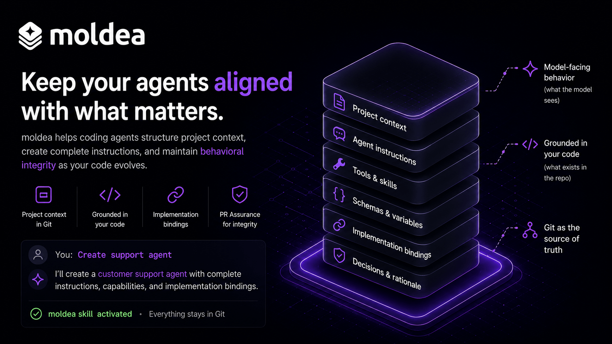

# moldea Agent Skill

[Get moldea on skills.sh](https://www.skills.sh/moldea-ai/skill/moldea) or read the complete documentation at [skill.moldea.ai](https://skill.moldea.ai).

This checkout targets release `8.2.6`. Install the latest published version from `main` inside each repository that will use it:

```bash
npx skills add moldea-ai/skill
```

For a reproducible installation, pin the immutable release after publication:

```bash
npx skills add "moldea-ai/skill#v8.2.6"
```

Both commands install the portable skill named `moldea`. They do not install the CLI globally or require a hosted account. See [Getting started](docs/getting-started.md) for initialization, updates, and removal.

## What `moldea` is

`moldea` helps developers keep durable project knowledge in Git and bring relevant context into coding-agent planning and development. Start with project purpose, rules, and decisions, even when your application has no runtime agents. The same foundation supports creating and maintaining runtime agents, reusable Agent Skills, and their instructions.

Adopted projects own a canonical `/moldea/**` tree. Focused context, implementation relationships, runtime guidance, mirrors, and unresolved requirements are added only when current project evidence calls for them.

The skill helps a coding agent:

- initialize the minimum useful project state when explicitly requested
- use and maintain relevant project knowledge during planning and development
- plan agent-enabled systems and decide what should remain ordinary software
- create and maintain grounded agents and reusable Agent Skills
- keep affected canonical knowledge aligned with implementation work
- evaluate, reconcile, repair, and structurally validate established state

After initialization, ask naturally to plan, build, review, or maintain AI agents, including model instructions and responsibilities in one-shot calls and workflows. Established project facts, approved policies, clear corrections, and project-context questions also receive bounded assessment without naming `moldea` or a file. Ordinary implementation requirements still use declared relationships, even when their effects will persist. When ordinary work expands to newly discovered paths, the coding agent checks those paths once at an existing scope checkpoint and preserves earlier matched owners. Only explicit initialization creates a new setup.

### Common requests

| Outcome          | Example request                                                  |
| ---------------- | ---------------------------------------------------------------- |
| Initialize       | `Initialize moldea`                                              |
| Use context      | `Use the saved API rules to plan the next change.`               |
| Plan             | `Plan the agents for this project's support-triage workflow.`    |
| Create an agent  | `Create a support agent grounded in the current project policy.` |
| Maintain context | `Update moldea context for the approved refund policy.`          |
| Evaluate         | `Evaluate the current moldea project.`                           |
| Reconcile        | `Reconcile the billing agent with its declared implementation.`  |
| Repair           | `Fix moldea.`                                                    |
| Validate         | `Validate moldea.`                                               |

Evaluation is read-only. Repair checks every owner, its material implementation relationships, and each agent's instruction connection. It corrects established errors and updates local CLI tooling that is missing, broken, older than the exact target recorded by the installed skill, or not satisfying its declaration. A large repair continues by owner from a reported checkpoint; an incomplete pass is never called healthy. Repair preserves host restrictions, healthy newer compatible tooling, and unresolved policy. Validation checks declared files and explicit TypeScript or JavaScript ESM exports. Coverage names what was checked and does not prove runtime wiring. Warnings do not invalidate a project: ask to fix them or explicitly accept a supported warning with your own reason. The coding agent never chooses acceptance on your behalf.

## Documentation

| Need                                                               | Authority                                                                                     |
| ------------------------------------------------------------------ | --------------------------------------------------------------------------------------------- |
| Install, initialize, update, or remove the skill                   | [Getting started](docs/getting-started.md)                                                    |
| Understand activation, operations, evidence, and change boundaries | [Workflow reference](docs/how-it-works.md)                                                    |
| Explore supported outcomes and examples                            | [Capabilities](docs/capabilities.md) and [examples](docs/examples/index.md)                   |
| Understand canonical project state and its repository layout       | [Project state](docs/project-state.md) and [repository format](docs/repository-format.md)     |
| Plan an agent system                                               | [Planning agent systems](docs/planning-agent-systems.md)                                      |
| Design agents or Agent Skills                                      | [Designing agents](docs/designing-agents.md) and [designing skills](docs/designing-skills.md) |
| Maintain or compress accumulated context                           | [Continuous maintenance](docs/continuous-maintenance.md)                                      |
| Evaluate, reconcile, validate, or repair                           | [Evaluate, reconcile, and validate](docs/evaluate-reconcile-validate.md)                      |
| Understand warnings, unfinished checks, and large inputs           | [Limitations](docs/limitations.md)                                                            |
| Inspect compatibility, local tooling, and resource limits          | [Compatibility and local tooling](docs/compatibility-and-local-tooling.md)                    |
| Review instruction-loading behavior                                | [Reference-reading checks](docs/reference-reading.md)                                         |
| Run semantic evaluation                                            | [Semantic evaluation](docs/semantic-evaluation.md)                                            |
| Run subscription-based ChatGPT and Claude journeys                 | [Scripted journeys](docs/scripted-journeys.md)                                                |
| Select fresh or pinned release evidence                            | [Release evidence](docs/release-evidence.md)                                                  |
| Browse all public documentation                                    | [Documentation index](docs/index.md)                                                          |

## Compatibility

Release `8.2.6` supports exactly:

- Git `>=2.30.0`
- Node.js `>=22.17.0`
- stable `@moldea.ai/core` releases satisfying `^7.0.0`
- stable `@moldea.ai/cli` releases satisfying `^11.0.0`
- repository format version 1
- CLI JSON schema 7

The CLI must be a repository-root-local development dependency whose manifest declaration and installed stable version satisfy the supported range. The launcher also checks that installed Core satisfies both the CLI's declared Core range and `moldea`'s supported range. The package manager and repository setup or CI own lockfile consistency; the launcher does not check target-project lockfiles. The skill never falls back to a global installation, another workspace, a package-manager launcher, or a transient download. Tooling establishment belongs only to authorized write-capable work. See [Compatibility and local tooling](docs/compatibility-and-local-tooling.md) for the complete launcher, machine-output, resource, and runtime contracts.

## How it works

Initialization creates `/moldea/moldea.yaml` and `/moldea/project.md`, an explanatory README region, and a small managed AGENTS.md routing block when host instructions permit. It inventories existing agents, inline model workflows, documents, decisions, and project-owned Agent Skills, links existing document authorities in place, and registers evidenced agents and workflows in the same operation. Before registration or application-code changes it asks one confirmation unless initialization already includes the agents. A bounded partial pass resumes with `continue`; one final validation and report cover the completed batch. Projects without agents retain the minimal foundation flow. For ordinary work, that block runs the two-byte relevance gate over already-known paths before loading SKILL.md. A miss continues silently without loading the entrypoint, workflow references, or CLI. Direct agent and project-context work keeps the skill’s own routing.

After adoption, clear AI-agent work and concrete project-level context use the adoption-only route. Explicit `moldea` operations, canonical paths, and changes inside the managed README block also activate directly. Other known task paths use the AGENTS.md precheck and declared relationship matching. Host planning, review, commit, and publication workflows keep control of their own procedures. Generic terminology, pasted proposals, temporary status, and lasting code changes alone do not establish direct relevance. Irrelevant work receives no `moldea` announcement or status.

Informational handoffs and read-only questions permit assessment, not automatic writes. A clear correction to established project truth authorizes its minimal canonical update after adoption and ownership checks, unless the request is read-only. Authorized updates preserve unrelated state and end with validation; they do not authorize implementation changes or broad context discovery.

The entrypoint keeps routing and essential boundaries compact. It loads only the operation-specific references needed for the selected work. Complete unchanged instructions may be reused while available; missing instructions after compaction must be read again, and summaries never replace instructions, repository evidence, or authorization. See the [workflow reference](docs/how-it-works.md) and [reference-reading checks](docs/reference-reading.md).

Mechanical repository evidence uses the installed skill's closed launcher. It exposes bounded `inspect`, `scope`, `content`, `validate`, and `composition` operations without making canonical document bodies part of ordinary metadata output. It normalizes repository-relative content paths and verifies response identity, status, and inspection/validation diagnostic totals before forwarding unchanged output. Detailed invocation, pagination, failure, and runtime guidance belongs to [Compatibility and local tooling](docs/compatibility-and-local-tooling.md).

Repair uses a bundled helper for bounded checkpoint, continuation and written-file Git evidence. It refuses executable repository filters before status or diff. Repair continuation checks combine actual actor Git-wrapper records with recognized command syntax. Direct trusted-host calls are counted separately and supply neither actor violations nor positive read credit. Disallowed actor forms in either fail; opaque commands without Git calls do not fail merely for being opaque. This measures cooperative compliance, not resistance to deliberate evasion. Published coverage gaps and included continuation scenarios are disclosed in [Semantic evaluation](docs/semantic-evaluation.md#cases-and-coverage). Semantic execution may project one fixed repository-root direct Node correctness-test invocation into aggregate pass/fail facts. Package-manager commands cannot contribute correctness evidence, and the projection never retains test names, assertions, paths, durations, or output bodies.

### Safety and authority boundaries

Before adoption, a non-repository informational question is answered without repository inspection. Only explicit initialization creates canonical project state. An explicit setup validation, evaluation, or inspection request can diagnose a failed adoption check with bounded read-only foundation inspection. Repair may recover an established but damaged setup with the required authority; neither route silently initializes an unrelated repository. If no independent host task remains after abstention, the coding agent reports only a neutral repository outcome. A changed topic resets relevance and authorization instead of inheriting them from earlier agent work.

For ordinary repository paths, the AGENTS.md precheck runs before loading SKILL.md. The relevance gate accepts the relative spellings produced by Git, normalizes them to repository-logical paths, and emits only `0` or `1` without executing repository dependencies. The first check covers all host-known paths. A later check covers only materially new paths independently discovered during the host task; unchanged paths reuse their decision. A hit permits one bounded relationship query for its batch; it does not authorize loading every canonical record. The coding agent selects the smallest affected owner set, reads only the content needed for the task, and validates material canonical writes. An unrelated batch miss adds no `moldea` activity and does not erase an earlier matched owner.

Evaluation is read-only across ordinary repository files, Git state, configuration, submodules, the installed portable skill, and declared related repositories. Structural validation proves repository shape, not behavioral completeness. Claims still require repository evidence, and unresolved developer decisions remain explicit instead of being converted into invented policy.

Tooling establishment occurs only during authorized write-capable work and only after sufficient project context exists. Executable package-manager extensions stop automatic setup rather than being bypassed. Package identity and containment checks protect the launcher boundary, but they do not authenticate executable contents or provide an operating-system sandbox; the host's trust and execution controls remain authoritative.

## Report a problem

If `moldea` fails or behaves unexpectedly, email [jesus@moldea.ai](mailto:jesus@moldea.ai). Describe what you asked your coding agent and what happened instead. Include the error message and your skill, CLI, Node.js, Git, and operating system versions. Remove private code, secrets, credentials, and personal data before sending.

## Project blueprint

`moldea` is a portable Agent Skill with deterministic conformance, semantic evaluation, scripted journeys, evidence publication, and documentation tooling. The website renders selected evidence snapshots and independently recorded mock-project runs. It has no evaluator responsibility.

Scripted journeys cover six journeys and 21 requests in ordinary ChatGPT and Claude projects. Either provider can run selected whole journeys from an immutable commit-pinned bundle. Trusted checks run locally; initial failures use the shared two-of-three confirmation quorum with fresh-chat operator observations. Campaign scope and provider coverage remain separate. The optional third evidence section shows requests, changes, replies, checks, and provenance. Procedural adherence, actual instruction consumption, and complete consumer cleanup remain explicitly unverified where the suite does not establish them. The website preserves initial failures, every admitted confirmation, partial coverage and historical provenance. These selected observations do not estimate platform-wide reliability.

| Area                                      | Responsibility                                                                                                                                                            |
| ----------------------------------------- | ------------------------------------------------------------------------------------------------------------------------------------------------------------------------- |
| `moldea/`                                 | Complete distributed Agent Skill: entrypoint, focused references, host metadata, managed document assets, and bounded generated scripts.                                  |
| `src/`                                    | Maintained TypeScript for portable generation, isolated execution, semantic evaluation, scripted journeys, evidence assets, release checks, and shared developer tooling. |
| `evidence/selection.json`                 | Exact maintainer selections for semantic evidence and optional scripted journeys.                                                                                         |
| `website/`                                | Static documentation and evidence presentation, including independently selected mock-project runs, sanitized session replays, and source links.                          |
| `fixtures/`                               | Deterministic source fixtures and calibration records. Recorded evaluation attempts are not committed.                                                                    |
| `docs/`                                   | Concise public concepts and durable workflows. API and HTTP endpoint documentation does not belong here.                                                                  |
| `project-specification`                   | Read-only development reference to the canonical product and skill specifications in `../platform/moldea`.                                                                |
| `.github/workflows/conformance.yml`       | Conservative PR selection, root correctness, quality, and portable Linux, Windows and macOS contracts.                                                                    |
| `.github/workflows/website-checks.yml`    | Shared read-only website quality and artifact verification; browser suites run locally.                                                                                   |
| `.github/workflows/pages.yml`             | Pages preflight, parallel verification/production build, and gated deployment.                                                                                            |
| `.github/workflows/release-candidate.yml` | Exact package-candidate validation without publication.                                                                                                                   |

Scripted-journey composition assembles one website snapshot from explicit local records. Whole provider/journey groups can update independently; retained results keep their original requests, versions, methods, dates and raw artifacts. New tests may have evidence from only one provider. Partial or mixed snapshots can display but do not satisfy current release assurance.

The distributed artifact is exactly `moldea/`; development-only tooling is not installed with the skill. Portable builds use fixed compiler settings in checkouts and temporary release directories. Run `npm run matcher:generate` after changing the relevance gate's locked inputs and `npm run matcher:check` to verify the committed artifact.

## Authoritative project specifications

The sibling `platform` repository owns the canonical `moldea` product and skill specifications. The root `project-specification` symlink targets `../platform/moldea`. Before work that requires those specifications, read the [project foundation](project-specification/project.md), then only the relevant focused context. Start with the [Agent Skill specification](project-specification/context/agent-skill.md) for skill behavior and follow its references as needed.

Specifications define intended product requirements and design constraints. This repository owns the skill implementation, public documentation, compatibility declarations, and release evidence. The `packages` repository owns the [public Repository Format](../packages/specifications/repository-format.md), package implementations, tests, and releases. Specifications alone do not establish shipped behavior or availability. Report conflicts or version drift and establish the affected authority before changing a contract; do not silently regress supported behavior to match an older specification.

This reference is read-only by workflow, not filesystem permissions. Never create, modify, move, or delete files through `project-specification/`. Changes to its authority require separate authorization in the owning platform checkout. A working native symlink and adjacent platform checkout are required to use the reference. If required specifications are missing, inaccessible, or the checkout contains a link-text file instead of a symlink, report the problem and stop the specification-dependent work. Do not copy specifications here or change host settings as a fallback.

The reference is for repository development only. Builds, tests, CI, and installed skill behavior remain independent of the sibling checkout. The link and its target are outside the distributed `moldea/` artifact and must not be bundled or published as skill content.

## Development

Repository development requires Node.js `^24.15.0` and npm `>=10.9.0`. The distributed `moldea/` artifact keeps its documented Node.js `>=22.17.0` runtime contract.

Install every workspace dependency from the repository root without lifecycle scripts:

```bash
npm ci --ignore-scripts
```

To prepare an exact published CLI release, run `npm run release:update-cli -- <version>`. The updater verifies the published CLI, installs its locked dependency closure in a temporary directory, regenerates portable scripts from maintained TypeScript, and checks release identity before completing. It restores files it changed if preparation or verification fails, while preserving concurrent edits. Run `npm ci --ignore-scripts` afterward to bring local dependencies in line with the updated lockfile before running conformance checks.

Before publication, `npm run candidate:prepare -- --artifacts <packed-closure-directory> --output <empty-directory-outside-this-repository>` prepares a complete isolated skill through the same updater against the candidate registry. An optional `--release-version <version>` selects the isolated skill version. The release-candidate workflow uses this full distribution for real manager and closed-launcher checks. Candidate registry URLs stay in the disposable output; they must not enter the official release lockfile. These checks establish tooling mechanics, not coding-agent repair effectiveness.

The same release-candidate workflow is reusable by the packages trusted build. Its caller pins the skill workflow and tooling to the same immutable commit and supplies that run's public-package artifact and exact packages commit. It also passes its reviewed registry snapshot, so manager installs resolve third-party dependencies only from versions published before that instant; an empty snapshot resolves live. `src/packages/trusted-candidate.ts` verifies the recorded source identity, complete checksum manifest and package graph before copying the CLI closure. The full verified public set, including Website UI, prepares the isolated skill; the manager matrix then consumes the unchanged CLI closure tarballs. The workflow requires only read access and cannot publish packages.

Source and packed package candidates accept stable caret dependency minimums, including patch minimums such as `^2.0.3`. Candidate validation checks every resolved internal runtime package against its declared range; exact internal runtime dependency pins and incompatible versions are rejected.

The root tooling and website consume Website UI `4.1.0` with the exact Astro `7.2.8` peer. Normal dependency resolution selects these versions without an override.

Run the deterministic boundaries:

```bash
npm run runtime:build
npm run portable:check
npm run test:unit
npm run test:integration
npm test
npm run typecheck
npm run lint
npm run format:check
npm run path:check
npm run docs:check
npm run website:check
```

Conformance runs root correctness once on development Node, every portable integration file on all three supported Node versions on Linux, and the same portable files on Windows and macOS. Windows also checks deep-path cloning and installation. Only PR changes entirely within `website/src/components/`, `website/src/layouts/`, `website/src/pages/`, `website/src/styles/`, or `website/public/` skip heavy conformance; the global path check and full website verification still run. Shared, unknown, mixed, and tag changes receive full conformance. `Conformance result` and `Verify Website` report selected-check failures and unexpected skips; configuring them as required checks is a separate repository setting. PR website verification owns website typechecking; tag conformance retains that check. PRs and Pages share read-only website quality and artifact verification. Recorded-browser and clean-development browser suites run locally before merging. Pages verification and the official production build run independently after shared configuration preflight; deployment requires both to succeed. `typecheck:root` checks root tooling, while `typecheck` still checks all workspaces.

`npm test` includes the website browser suite. Production `website:build`, `release:check`, and Pages deployment require the semantic evidence selection to be populated and prepared. Development website checks exercise both the clean current catalogs without recorded results and isolated synthetic evidence.

Specialized workflows have focused operator references:

| Workflow                                                   | Start here                                                                 |
| ---------------------------------------------------------- | -------------------------------------------------------------------------- |
| Resource profiles and calibration                          | [Compatibility and local tooling](docs/compatibility-and-local-tooling.md) |
| Semantic preflight, diagnosis, recording, and verification | [Semantic evaluation](docs/semantic-evaluation.md)                         |
| Scripted journeys in ChatGPT and Claude projects           | [Scripted journeys](docs/scripted-journeys.md)                             |
| Fresh or explicitly pinned release evidence                | [Release evidence](docs/release-evidence.md)                               |

## Releases

The skill uses independent semantic versioning. Every release must:

- record its exact version in `moldea/SKILL.md`
- declare the compatible CLI major; evidence-backed production releases also bind the exact evaluated CLI closure plus CLI JSON schema in release evidence
- pass current conformance; evidence-backed production releases also select verified fresh or explicitly pinned semantic evidence
- preserve identical `moldea/` bytes across official distribution channels
- use an immutable `v<version>` tag

During prelaunch testing, skill tags require deterministic conformance, synchronized release identity, and installation checks. Semantic evaluation is a separate evidence-backed operation; a passing tag does not establish it. The selected 8.2.3 semantic recording contains 120 cases: 115 passed and five recovered. Its final cleanup reused verified full-recording and reserve trials without new model calls. Two unresolved cases remain private and are disclosed as not yet included. Historical evidence preserves its recorded versions, dates and sources and supplies no current-release assurance. See [Release evidence](docs/release-evidence.md) for the exact workflows.

Release 8.2.6 retains the selected 8.2.3 semantic evidence. Its resource-counting clarification, ordinary final-validation exception, repair CLI update rule and direct repair reads were not re-evaluated; see [the 8.2.4](docs/release-evidence.md#skill-824-evidence-reuse), [8.2.5](docs/release-evidence.md#skill-825-evidence-reuse) and [8.2.6](docs/release-evidence.md#skill-826-evidence-reuse) release qualifications.

## License

[MIT](LICENSE)
