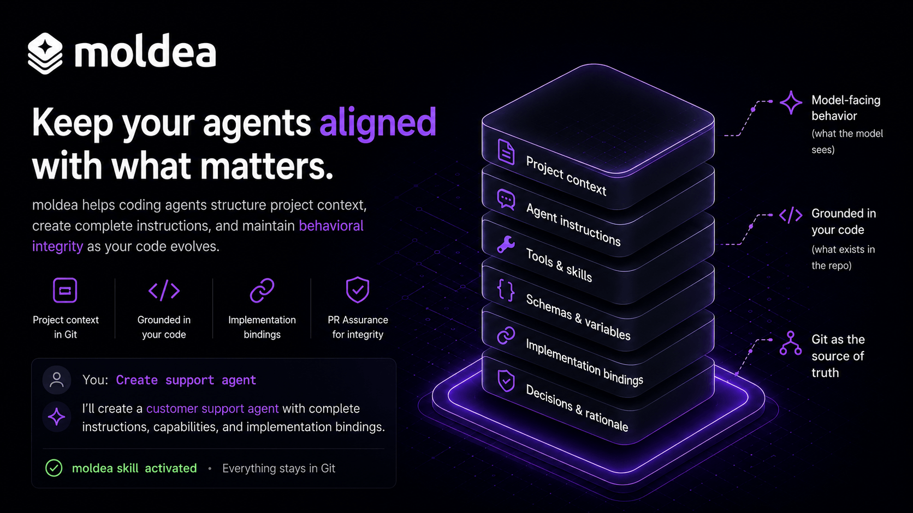

# moldea Agent Skill

`moldea` helps developers keep durable project knowledge in Git and bring relevant context into coding-agent planning and development. Start with project purpose, rules, and decisions, even when your application has no runtime agents. The same foundation supports creating and maintaining runtime agents, reusable Agent Skills, and their instructions.

Adopted projects keep their foundation in `/moldea/**`. Add focused context, decisions, agent assets, and implementation relationships as the project needs them.

## Installation

[Get moldea on skills.sh](https://www.skills.sh/moldea-ai/skill/moldea) or read the complete documentation at [skill.moldea.ai](https://skill.moldea.ai).

This checkout contains `moldea` `11.0.1`. Install the latest published version from `main` inside each repository that will use it:

```bash
npx skills add moldea-ai/skill
```

For a reproducible installation, pin the immutable release after publication:

```bash
npx skills add "moldea-ai/skill#v11.0.1"
```

Both commands install the portable skill named `moldea`. The skill ships its CLI, runs with Node in the Git worktree, and requires no hosted account. See the [Setup reference](docs/getting-started.md) for initialization, updates, and removal.

## Project blueprint

| Need                                                               | Authority                                                                                     |
| ------------------------------------------------------------------ | --------------------------------------------------------------------------------------------- |
| Install, initialize, update, or remove the skill                   | [Setup reference](docs/getting-started.md)                                                    |
| Understand activation, operations, evidence, and change boundaries | [Workflow reference](docs/how-it-works.md)                                                    |
| Explore supported outcomes and examples                            | [Capabilities](docs/capabilities.md) and [examples](docs/examples/index.md)                   |
| Understand canonical project state and its repository layout       | [Project state](docs/project-state.md) and [repository format](docs/repository-format.md)     |
| Plan an agent system                                               | [Planning agent systems](docs/planning-agent-systems.md)                                      |
| Design agents or project-grounded Agent Skills                     | [Designing agents](docs/designing-agents.md) and [designing skills](docs/designing-skills.md) |
| Maintain or compress accumulated context                           | [Continuous maintenance](docs/continuous-maintenance.md)                                      |
| Check or fix project context and validate structure                | [Check, fix, and validate](docs/check-fix-validate.md)                                        |
| Understand warnings, unfinished checks, and large inputs           | [Limitations](docs/limitations.md)                                                            |
| Inspect compatibility, local tooling, and resource limits          | [Compatibility and local tooling](docs/compatibility-and-local-tooling.md)                    |
| Review instruction-loading behavior                                | [Reference-reading checks](docs/reference-reading.md)                                         |
| Run semantic evaluation                                            | [Semantic evaluation](docs/semantic-evaluation.md)                                            |
| Select fresh or pinned release evidence                            | [Release evidence](docs/release-evidence.md)                                                  |
| Browse all public documentation                                    | [Documentation index](docs/index.md)                                                          |

| Repository work                                                                    | Owner                                                                                                                                                         |
| ---------------------------------------------------------------------------------- | ------------------------------------------------------------------------------------------------------------------------------------------------------------- |
| Find source responsibilities, set up development or consult product specifications | [Repository development](docs/compatibility-and-local-tooling.md#repository-development), including the read-only sibling boundary and portable distribution. |
| Choose checks and understand CI/release qualification                              | [Testing](docs/testing.md), covering essential/full selection, evaluator prerequisites and manual cadence.                                                    |
| Work on documentation and evidence presentation                                    | [Website guide](website/README.md), covering source discovery, builds, evidence and deployment.                                                               |
| Integrate and deliver changes                                                      | [Task delivery](docs/delivery.md), with ordered stops, operators and verification.                                                                            |

The installed artifact is exactly `moldea/`. `src/` owns development tooling, `docs/` owns public guides, and `website/` presents documentation and selected evidence. Evaluation, provider journeys and website delivery retain their own procedures; they are outside the installed portable skill.

## Report a problem

If `moldea` fails or behaves unexpectedly, email [jesus@moldea.ai](mailto:jesus@moldea.ai). Describe what you asked your coding agent and what happened instead. Include the error message and your skill, CLI, Node.js, Git, and operating system versions. Remove private code, secrets, credentials, and personal data before sending.

## License

[MIT](LICENSE)
